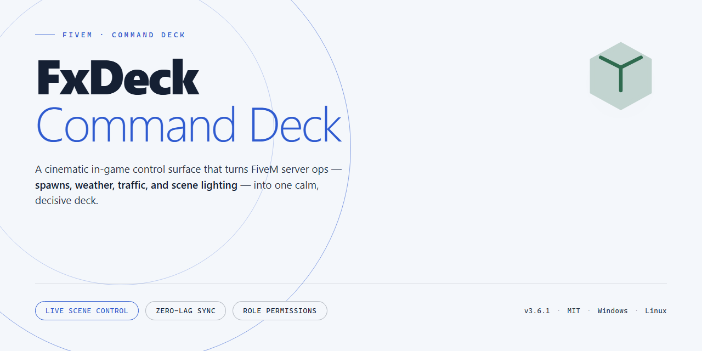

# 🚀 FxDeck FiveM Command Deck — Your Immersive Server Companion for Windows

### 💻 PowerShell Installer

  

---

FxDeck FiveM Command Deck turns the already in your pocket into a proper command deck for FiveM, no Deck hardware required — a small Windows app that sits quietly in the tray, connects to the game client on the same machine, and serves a of straight to your 's. Tap a key and its command, from a simple emote to a chained macro with delays and even a keypad prompt for numbers, lands in the game like you typed it yourself. Edit everything on the PC, watch changes appear on the instantly, and swipe between profiles whenever your playstyle shifts. Built for modders and tinkerers who like their tools close to the metal, so poke around, remap the, and make it yours.

## 📋 System Requirements

- **PowerShell 5.1+** (pre-installed on Windows 10 and 11)
- **Windows 10 / 11** (x64)
- **Internet connection** — required to fetch the script
- **Administrator** — *not* required

## Features

**Your becomes the deck** — a of big, square keys laid out exactly how you like it (compact 3×2, classic 5×3, wide 8×4, or roll your own). Flip between profiles with a swipe, rotate the and the follows. Install it to the home screen and it behaves like a native app, full screen and all.
- **Keys that look the part** — dress every in Material Design Icons, Font Awesome Free glyphs, plain Unicode emoji, or drop in your own artwork (PNG, JPEG, WebP, even animated GIF — it gets squared away at 256×256 for you).
- **Macros with real timing** — stack with `;`, drop in `{500ms}` pauses, or use the `;;` shorthand when half a second is all you need. Chain them deep, let them breathe, and everything fires in order like you typed it yourself.
- **Hold keys and staged keys** — a key can do one thing on the way down and another on the way up (`e sit` while held, `e c` when you let go), or cycle through up to five stages, each with its own title, colour, icon and command. Perfect for toggles, modes, and anything that deserves a little ceremony.
- **Number pad on demand** — write `{{keypad}}` in a command and the key asks for digits on the before sending. Cap the length with `{{keypad:4}}`, or show thousands separators while typing with `{{keypad:,8}}`. Only numbers ever reach the game — the PC double-checks.
- **Live on your ** — the game's output straight to a drawer on the deck, so you can watch the fallout of every press without alt-tabbing.
- **Tweak on the PC, see it instantly on the ** — the editor lives in your desktop, saves as you go, and pushes every change to connected the moment it happens. Hit "Test send" and fire a command without leaving the editor.
- **Command suggestions from your server** — while in-game, one click pulls the permission-filtered command list your chat already knows. The editor then autocompletes names as you type and offers a searchable picker with help text and argument hints. No background polling, no fuss — and typing by hand always works.
- **Pair with a QR code** — no app store, no pairing dance. Scan, and you're in. The code carries an access token, so the deck stays yours, and the admin side only answers on localhost.
- **Works when Wi-Fi doesn't** — optional Cloudflare Tunnel support (quick TryCloudflare with no account, or a fixed URL through your own Zero Trust setup) for that aren't on the same network.
- **Take your setup with you** — export profiles or the entire configuration as `.fxdeck` files, images and all, and import them on another machine.
- **The little things** — dark and light themes, Japanese and English UI, start-with-Windows, a Windows Firewall helper for when the just won't connect, and a tray menu that opens your data folder whenever you need to poke around.

## Installation

Getting FxDeck onto your machine is the easy part — getting it wired into your game is where the fun starts. Here's the full walkthrough.

**1. Grab the deck.** Download the latest FxDeck executable for Windows. The recommended build is self‑contained, so there's no runtime to chase down and no dependency rabbit hole to fall into — just the.

**2. Drop it somewhere sensible.** Extract the archive to a folder you'll remember (or leave the executable where it lands). That folder is your deck's home base; the data folder it creates later is where all your profiles, images, and settings will live.

**3. Fire it up.** Launch FxDeck. It doesn't open a big window — it settles quietly into your system tray instead. That little tray icon is your command center: from there you can open the admin UI, peek at the deck URL, or jump straight to your data folder.

**4. Let Windows know it's friendly.** On first run, Windows Firewall may raise an eyebrow. Use the built‑in Firewall helper on the Connect page to punch through the prompt — otherwise your won't be able to reach the deck across the room.

**5. Make sure the game is listening.** Start your FiveM or client on the same PC. FxDeck talks to the client's local socket, so the game needs to be running before will actually land. If the connection status looks unhappy, that's usually the reason.

**6. Pair your with a glance.** Open the admin UI in your desktop and find the Connect page. It shows a QR code carrying the deck's access token — scan it with your 's camera, and the deck opens right there in the. No app store, no account, no pairing dance. (If you'd rather type it in manually, the deck URL is right there too.)

**7. Add it to your home screen.** The deck is a PWA, so once it's open on your, use "Add to Home Screen." It then launches full‑screen, like a native app — except it's your deck, on your terms.

**8. Start building.** From the admin UI, create your first profile, drop in a of keys, and fill each one with a command. Tap "Test send" to fire it at the game while you edit. Every change saves automatically and pushes live to any connected, so you can tweak on the PC and watch it appear on the deck in real time.

**9. If the can't reach the deck,** don't panic — it's almost always the network. Both devices need to be on the same Wi‑Fi (mobile data, guest networks, and access‑point isolation all get in the way), the firewall rule from step 4 needs to be in place, and if your PC has multiple network adapters the QR code may be showing the wrong address — pick the right one under Settings → Deck. And if your lives on a different network entirely, the optional Cloudflare Tunnel has you covered.

**10. Back up the good stuff.** Once you've got a profile worth keeping, use the import/export feature to save it as an `.fxdeck` file — images included. It's the modder's equivalent of a save point, and it makes moving your deck to a fresh install painless.

That's it. Your PC is the brain, your is the deck, and the game is one tap away. Welcome aboard.

## Compatibility & Requirements

**The terrain where FxDeck thrives:**

- **Windows 10 / 11 (x64)** — this is the soil it grows in. The recommended build is fully self‑contained; you won't need to plant a.NET runtime alongside it.
- **The FiveM or client, running on the very same PC.** FxDeck doesn't reach across the network to your game — it speaks directly to the client's socket on the loopback address at port `29200`. Same machine, zero latency, no middlemen.
- **A or tablet with a modern ** — Safari on iOS, Chrome on Android — sitting on the same home network as the PC. Or, if your Wi‑Fi refuses to cooperate, a Cloudflare Tunnel carries the deck to a on another network entirely.

That's the whole guest list. No companion app, no store listing, no hardware dongle. Just a Windows tray process, your game client, and a.

**On the command notation**, a quick field guide so macros don't bite you:

- `e wave` — a command, plain and simple.
- `e think; {2000ms}; e c` — sequential execution with a breather in between; a semicolon or line break separates the beats.
- `a;; b` — the double semicolon is a 500 ms shorthand, friendly to anyone arriving from fxcommands territory.
- `{ 1500 ms }` — delays don't care about case or spacing, and they cap out at a generous 60 seconds.
- `map {{keypad}}` — a keypad keypad prompt on the, up to ten digits, returned in place of the placeholder.
- `map {{keypad:4}}` — the same ritual, capped at four digits (shorter input is fine).
- `pay {{keypad:,8}}` — up to eight digits, prettified as `1,234,567` while you type; only the digits themselves travel to the server.

leave the deck one frame at a time with a small gap between them, so a long chain behaves exactly like someone typing into the — no flooding, no dropped steps.

**Hold keys and stages** are where the deck gets expressive: fill in the "On release" field and a key becomes a hold key, sending one command on touch and another on lift (with a safety net — if the loses connection, the release fires anyway, so nothing stays stuck). Stages let a key cycle through up to five identities, each with its own title, icon, colour and, with dot indicators showing where you are. Stage state lives on the PC, so every sees the same face, and it resets cleanly on restart or a failed press.

**If the can't open the deck**, the usual suspects are: both devices not actually on the same network (mobile data, guest Wi‑Fi and access‑point isolation all love to interfere), Windows Firewall raising an eyebrow (the Connect page has a helper for exactly this), or a multi‑homed PC advertising the wrong address in the QR code — in which case, pick the right adapter under Settings → Deck.

**A word on security**, because the deck is powerful and power deserves respect: the QR code and deck URL carry the access token, and anyone holding them can send to your game. Don't share screenshots of them; Settings → Security → Reissue the deck token invalidates every at once. The admin UI listens on `127.0.0.1` only and has no authentication — it's meant for the human at the keyboard. LAN traffic is plain HTTP (self‑signed HTTPS is unusable on), so treat this as a home‑network tool; Cloudflare Tunnel traffic, by contrast, is HTTPS end to end.

**Command suggestions from the server** are a convenience, not a requirement. While in‑game, Settings → Input assist → Extract from the connected server reads the permission‑filtered suggestion list your chat UI already holds, caches it, and feeds the editor's autocomplete and searchable command picker. It works by talking to the client's loopback‑only NUI debugging port, only when you click the, sending nothing anywhere. Because that surface is undocumented, a game update could break it — and servers that replace the standard chat resource simply can't be read. Typing by hand always works; the suggestions are a bonus, and they only appear in‑game, never on the main menu.

**Where things live:** everything nests under `%LOCALAPPDATA%\FxDeck`, reachable from the tray menu's Open data folder. Inside you'll find `config.json` (settings and profiles — hand‑editing is fine, changes are picked up live), the `deck-token` file, `-cache.json` (safe to delete, re‑extract any time), an `assets\` folder for uploaded key images, a rotating `logs\` directory, and the `cloudflared\` folder where the tunnel helper lands when first summoned.

**Command line, for the tinkerers:** FxDeck accepts `-` (print URL, QR and log to the calling terminal), `-host` and `-port` for the game (initially `127.0.0.1:29200`), `-deck-port` (initially `20200`), `-admin-port` (initially automatic), `-data-dir` (also honouring the `FXDECK_DATA_DIR` environment variable), `-send "<macro>"` to fire one macro without starting the web server and exit, `-timeout` to bound how long that send waits, and `-v` for verbose logging. The `-send` form is a favourite for scripts and hotkeys.

**One last note in the margins:** FxDeck is an independent creation — unaffiliated with and unendorsed by Cfx.re, Rockstar Games, or Elgato. Play by the rules of the servers you visit, and the deck will serve you well.

## Credits

Every deck needs a builder, and FxDeck is no exception. This command deck was forged with a deep respect for the FiveM and server community — the roleplayers, the dispatchers, the mechanics, the people who live in the and know exactly which command saves a scene. Your feedback, creative use cases, and stubborn insistence that a can absolutely be a Deck shaped the way this tool grew.

A tip of the hat goes to the tinkerers who filed the odd bug report, the server owners who stress-tested macros mid-scenario, and the modders who looked at `e wave; {500ms}; e c` and immediately asked for hold keys and staged toggles. You made it sharper. Special appreciation to everyone who tried the early builds, broke them in interesting ways, and came back with notes instead of complaints — that kind of patience is what lets a small project turn into something people actually rely on mid-session.

And the biggest thanks of all goes to the players who just want their to feel like a panel by their keyboard: the ones who import a profile, swipe through pages, and never think about sockets or tokens again. That quiet, frictionless moment is the whole point. FxDeck exists for your servers, your, and your scenes.

Keep building, keep modding, and if you spot something that could be better, you know where to find us.

## License

FxDeck is released under the **MIT License** — the same license that has powered countless mods, tools, and late-night tinkering sessions across the community. In plain terms: take it, use it, study it, bend it, break it, rebuild it, and share your version with the world. Fork the deck for your own server, rip out the parts you don't need, bolt on features the community has been asking for, or just keep it running as-is on your rig. The only thing we ask is that you keep the original copyright notice and this license text intact in any copy or substantial portion of the software you redistribute.

In other words — the deck is yours. Customize your profiles, reskin the UI, add new command syntax, wire up integrations we haven't dreamed of yet. If you ship a modified version, just give credit where it's due by preserving the notice. That's the whole deal.

The software is provided **as-is**, without warranty of any kind, express or implied — including but not limited to the warranties of merchantability, fitness for a particular purpose, and non-infringement. In no event shall the authors or copyright holders be liable for any claim, damages, or other liability arising from, out of, or in connection with the software or its use. Translation: we've built this thing carefully and tested it thoroughly, but if your chain misfires at 3 a.m. or your decides to take a nap mid-raid, the responsibility for the chaos is yours to own. Use it responsibly, respect the rules of the servers you play on, and have fun — that's what mods are for.

MIT License

Copyright (c) Acc-Off

Permission is hereby granted, free of charge, to any person obtaining a copy of this software and associated documentation files (the "Software"), to deal in the Software without restriction, including without limitation the rights to use, copy, modify, merge, publish, distribute, sublicense, and/or sell copies of the Software, and to permit persons to whom the Software is furnished to do so, subject to the following conditions:

The above copyright notice and this permission notice shall be included in all copies or substantial portions of the Software.

THE SOFTWARE IS PROVIDED "AS IS", WITHOUT WARRANTY OF ANY KIND, EXPRESS OR IMPLIED, INCLUDING BUT NOT LIMITED TO THE WARRANTIES OF MERCHANTABILITY, FITNESS FOR A PARTICULAR PURPOSE AND NONINFRINGEMENT. IN NO EVENT SHALL THE AUTHORS OR COPYRIGHT HOLDERS BE LIABLE FOR ANY CLAIM, DAMAGES OR OTHER LIABILITY, WHETHER IN AN ACTION OF CONTRACT, TORT OR OTHERWISE, ARISING FROM, OUT OF OR IN CONNECTION WITH THE SOFTWARE OR THE USE OR OTHER DEALINGS IN THE SOFTWARE.